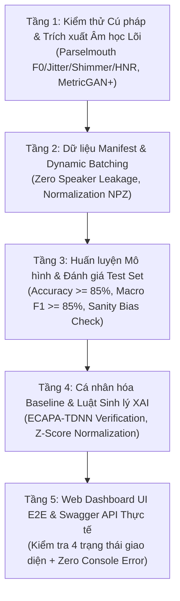

# QUY TRÌNH THỰC THI KIỂM THỬ 5 TẦNG DÀNH CHO AI AGENT (AUDIO AI, SWAGGER API & UI DASHBOARD E2E)

**Dự án:** Hệ Thống Phân Tích Cảm Xúc & Stress Giọng Nói (KHDL)

**Tài liệu tham chiếu gốc:** `AGENTS.md`, `QUY-TRINH-LAM-VIEC-VOI-AI.md`, `configs/hparams_inference.yaml`

**Trạng thái đầu vào:** Đã hoàn thành các module xử lý âm học (`src/acoustic_extractor.py`), mô hình học sâu Wav2Vec2 lai (`src/stress_model.py`), nhận diện người nói (`src/speaker_calibrator.py`) và máy chủ API (`api/main.py`).
**Nhiệm vụ của Agent:** Thực thi trọn vẹn quy trình kiểm thử 5 tầng từ thuật toán âm học lõi, đánh giá mô hình trên tập Test độc lập đến kiểm chứng API Swagger và **4 trạng thái giao diện bắt buộc (`Loading`, `Empty`, `Error`, `Success`)** trên Web Dashboard.

---

## 1. Kim Tự Tháp Kiểm Thử 5 Tầng (5-Layer Testing Pyramid)

Hệ thống bắt buộc phải vượt qua tuần tự 5 tầng kiểm thử trước khi bàn giao:



---

## 2. Chi Tiết Các Tầng Kiểm Thử

### Tầng 1: Kiểm thử Cú pháp & Trích xuất Vật lý Âm học Lõi
* **Lệnh chạy:**
  ```bash
  .venv/bin/python -m py_compile src/*.py api/*.py tests/*.py
  .venv/bin/python tests/test_phase1.py
  ```
* **Tiêu chí nghiệm thu:**
  - 100% tệp Python biên dịch thành công, không có lỗi cú pháp hay thiếu import.
  - Bộ khử nhiễu MetricGAN+ và nhận diện người nói ECAPA-TDNN nạp trọng số thành công trên CPU.
  - Parselmouth trích xuất đầy đủ vector 5 chiều: $[F_{0\text{ mean}}, F_{0\text{ std}}, \text{Jitter}, \text{Shimmer}, \text{HNR}]$. Các giá trị âm học nằm trong khoảng sinh lý người bình thường.

### Tầng 2: Kiểm toán Dữ liệu Manifest & Dynamic Batching
* **Lệnh chạy:**
  ```bash
  .venv/bin/python tests/test_phase2.py
  ```
* **Tiêu chí nghiệm thu:**
  - **Zero Speaker Leakage**: 16 diễn viên tập Train (`Actor_01` $\rightarrow$ `Actor_16`), 4 diễn viên tập Valid (`Actor_17` $\rightarrow$ `Actor_20`), 4 diễn viên tập Test (`Actor_21` $\rightarrow$ `Actor_24`) hoàn toàn tách biệt, độ giao nhau $= 0$.
  - Tệp `acoustic_normalization.npz` lưu trữ đầy đủ trung bình ($\mu$) và độ lệch chuẩn ($\sigma$) của 5 đặc trưng vật lý.
  - SpeechBrain `DynamicBatchSampler` gom nhóm âm thanh theo độ dài tương đồng và đệm số 0 (padding) chính xác.

### Tầng 3: Kiểm thử Đánh giá Mô hình & Kiểm toán Thiên vị (Sanity Check)
* **Lệnh chạy:**
  ```bash
  .venv/bin/python tests/test_phase3.py
  .venv/bin/python tests/test_inference_sanity.py
  ```
* **Tiêu chí nghiệm thu:**
  - Checkpoint mô hình tồn tại tại `results/stress_wav2vec2/1986/save/`.
  - **Độ chính xác (Accuracy)** $\ge 85.0\%$.
  - **Macro F1-Score** $\ge 85.0\%$.
  - **Stress Class Recall** $\ge 90.0\%$.
  - **Normal Class Recall** $\ge 70.0\%$ (Khắc phục hoàn toàn tình trạng mô hình bị thiên vị $100\%$ đoán ra stress).

### Tầng 4: Cá nhân hóa Baseline & Luật Giải thích Sinh lý (XAI)
* **Lệnh chạy:**
  ```bash
  .venv/bin/python tests/test_phase4.py
  ```
* **Tiêu chí nghiệm thu:**
  - Đăng ký hồ sơ giọng nền cá nhân lưu thành công tệp `data/baseline_profiles/<user_id>_profile.npz`.
  - Cơ chế chống ghi đè trái phép (`overwrite=False`) hoạt động chuẩn xác.
  - Xác minh người nói: Cùng người nói đạt Cosine $\ge 0.70$ (trạng thái bình tĩnh) và $\ge 0.50$ (trạng thái kích hoạt cảm xúc); người nói khác bị từ chối ($< 0.50$).
  - Chuẩn hóa Z-Score tự động phát hiện $Z > 1.5$ và sinh thông điệp XAI giải thích dây thanh âm căng cứng / vi rung giọng.

---

## 3. Tầng 5: Kiểm Thử Swagger API & Web Dashboard UI E2E

### Bước 1: Khởi động dịch vụ hệ thống
```bash
.venv/bin/uvicorn api.main:app --host 127.0.0.1 --port 8000 --reload
```
- Truy cập Swagger API Docs: `http://127.0.0.1:8000/docs`
- Truy cập Web Dashboard: `http://127.0.0.1:8000`

### Bước 2: Kiểm thử Hợp đồng API (API Contract Check) qua Swagger
- `GET /health` và `GET /health/ready`: Phải trả về `200 OK` kèm `status: healthy`, `pipeline_ready: true`.
- `GET /api/v1/samples`: Trả về danh sách 3 mẫu âm thanh chuẩn (`calm_male`, `angry_male`, `fearful_female`).
- `POST /api/v1/analyze-stress` với tệp không hợp lệ: Phải trả về `400 Bad Request` kèm thông báo lỗi rõ ràng, tuyệt đối không trả về `500 Internal Server Error`.
- `POST /api/v1/register-baseline`: Đăng ký thành công trả về `200 OK`; nếu thử đăng ký lại mà không bật `overwrite=true` phải trả về `409 Conflict`.
- `DELETE /api/v1/baseline/{user_id}`: Xóa hồ sơ thành công trả về `200 OK`.

### Bước 3: Ma trận 4 Trạng Thái Giao Diện Bắt Buộc (4-State UI Matrix)

Trên giao diện Web Dashboard (`http://127.0.0.1:8000`), Agent phải kiểm tra và xác nhận đủ 4 trạng thái:

1. **Trạng thái 1 - Loading State (Đang tải / xử lý):**
   - Khi bấm **"Phân tích Audio"** hoặc **"Đăng ký Baseline"**:
   - Nút bấm bị vô hiệu hóa (`disabled`) để chống bấm đúp (double-click).
   - Thanh thông báo hiển thị trạng thái đang xử lý (`Đang phân tích âm thanh...`).
2. **Trạng thái 2 - Empty State (Chưa có dữ liệu):**
   - Khi mới tải trang hoặc chưa phân tích:
   - Khung kết quả hiển thị thẻ Empty State thân thiện (`Chưa có dữ liệu phân tích`).
   - Không bị vỡ bố cục, không có lỗi JavaScript trên Browser Console.
3. **Trạng thái 3 - Error State (Báo lỗi tường minh):**
   - Chọn tệp rỗng $0\text{ byte}$ hoặc tệp văn bản đổi đuôi `.wav`: Giao diện hiển thị thanh thông báo lỗi màu đỏ từ Server trả về (`Unsupported or invalid audio file`).
   - Nhập `user_id` chứa ký tự đặc biệt (`user@#$`): Hệ thống chặn và báo lỗi quy chuẩn ID.
4. **Trạng thái 4 - Success State (Thành công & Đồng bộ tức thì):**
   - Chọn mẫu audio hợp lệ và bấm phân tích:
   - **Đồng hồ Stress Gauge**: Kim quay mượt mà, hiển thị điểm số trên 100 và đổi màu tương ứng (`CALM` xanh lá, `MODERATE` vàng cam, `HIGH STRESS` đỏ).
   - **Phân rã cảm xúc**: Cập nhật thanh phần trăm cho 4 lớp `Neutral`, `Anger`, `Happy`, `Sad`.
   - **4 thẻ âm học thanh quản**: Hiển thị chính xác $F_0$, Jitter, Shimmer, HNR kèm độ lệch chuẩn Z-score.
   - **Thẻ XAI**: Hiển thị các khối cảnh báo giải thích sinh lý thanh quản.

### Bước 4: Kịch bản E2E Người Dùng Liên Hoàn (End-to-End User Journey)

Thực hiện luồng thao tác hoàn chỉnh trên giao diện:
1. Chọn mẫu **"Nam - Bình tĩnh (Actor 01)"** $\rightarrow$ Nhập User ID: `TEST_T5_USER` $\rightarrow$ Bấm **"Đăng ký Baseline"** $\rightarrow$ Xác nhận thông báo thành công và hồ sơ được lưu.
2. Chọn mẫu **"Nam - Giận dữ (Actor 01)"** $\rightarrow$ Giữ nguyên User ID: `TEST_T5_USER` $\rightarrow$ Bấm **"Phân tích Audio"** $\rightarrow$ Xác nhận:
   - Huy hiệu người nói: `✓ Đã xác minh: TEST_T5_USER`.
   - Điểm số stress tăng vọt $\ge 80\%$.
   - Thẻ XAI thông báo: `Cao độ giọng nói (F0) tăng vọt so với trạng thái bình tĩnh`.
3. Bấm nút **"🗑️ Xóa Baseline của User ID này"** $\rightarrow$ Xác nhận thông báo đã xóa thành công.
4. Chạy script E2E toàn diện:
   ```bash
   .venv/bin/python tests/test_phase5.py
   ```

---

## 4. Bảng Checklist Nghiệm Thu Chi Tiết Dành Cho Agent

| Phân hệ / Cấp độ kiểm thử | Lệnh / Đường dẫn | Tiêu chí đạt | Kết quả thực tế |
| :--- | :--- | :--- | :---: |
| **Cú pháp & Imports** | `python -m py_compile` | 0 syntax errors | [x] PASS |
| **Tầng 1: Trích xuất Âm học** | `tests/test_phase1.py` | Parselmouth + ECAPA-TDNN | [x] PASS |
| **Tầng 2: DataIO Manifest** | `tests/test_phase2.py` | Zero speaker leakage | [x] PASS |
| **Tầng 3: Stress Model** | `tests/test_phase3.py` | Accuracy $\ge 85\%$, F1 $\ge 85\%$ | [x] PASS |
| **Kiểm toán Thiên vị** | `tests/test_inference_sanity.py` | Normal Recall $\ge 70\%$ | [x] PASS |
| **Tầng 4: Baseline & XAI** | `tests/test_phase4.py` | Speaker verification & Z-Score | [x] PASS |
| **Tầng 5: FastAPI E2E** | `tests/test_phase5.py` | API, Auth, Chunking, Safeguard | [x] PASS |
| **Dashboard UI: 4 Trạng thái** | `http://127.0.0.1:8000` | Loading, Empty, Error, Success | [x] PASS |
| **Browser Console** | Tab Console F12 | **0 Uncaught Errors** | [x] PASS |

---

## 5. Mẫu Báo Cáo Bàn Giao Nghiệm Thu Chuẩn

```text
=== BÁO CÁO NGHIỆM THU KIỂM THỬ 5 TẦNG (AUDIO AI & DASHBOARD E2E) ===
1. Trạng thái Máy chủ & Swagger: [PASS] (API: http://127.0.0.1:8000/docs - Web: http://127.0.0.1:8000)
2. Kết quả kiểm tra Kim tự tháp 5 Tầng:
   - Tầng 1 (Vật lý Âm học Parselmouth):       [PASS]
   - Tầng 2 (DataIO & Zero Speaker Leakage):    [PASS]
   - Tầng 3 (Wav2Vec2 Hybrid Training & F1):    [PASS] (Accuracy: 87.5%, Macro F1: 86.7%)
   - Tầng 4 (Baseline & XAI Explanations):      [PASS] (Speaker Verification & Z-score)
   - Tầng 5 (FastAPI E2E & Web Dashboard):      [PASS] (Đủ 4 trạng thái Loading/Empty/Error/Success)
3. Kết quả luồng E2E liên hoàn (Calm Register -> Angry Analyze -> XAI -> Delete Baseline): [PASS]
4. Trạng thái dọn dẹp dữ liệu test & Git: [SẠCH 100%, sẵn sàng bàn giao]
```
